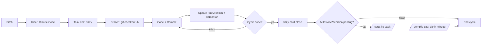

# /founderplus-cycle — Orchestrator Cycle Tim Product

Skill ini **tidak** menggantikan tools yang sudah ada. Fungsinya menjahit:

- **Fizzy** (via skill `fizzy` resmi) — task list, kartu, kolom, komentar
- **Git** — branch, commit, PR di repo kode
- **agent-changelog vault** — knowledge base permanen via `/catat` & `/compile`
  - Vault path: `~/Documents/Founderplus/agent-changelog/`

## Prinsip Inti

1. **Pitch turun → eksekusi → ship → catat.** 4 fase. Jangan lompat.
2. **Sumber kebenaran berbeda per artefak:**
   - "Apa yang dikerjakan minggu ini" → Fizzy
   - "Diff kode" → Git
   - "Kenapa keputusan ini diambil 3 bulan lagi masih perlu diingat" → vault
3. **Diam = invisible.** Setiap stuck/keputusan teknis → komentar Fizzy. Setiap milestone/decision strategis → `/catat`.
4. **Granularity Fizzy:** 1 kartu = 1 unit yang bisa di-ship & di-test sendiri. Target 3–5 kartu kecil/hari.

## Decision Tree — "Ini ditaruh di mana?"

```
Informasi yang mau disimpan?
├── Status task harian / subtask / komentar teknis per kartu
│   └── → Fizzy (komentar di kartu, atau kartu baru)
├── Diff kode / pesan commit
│   └── → Git (commit message singkat, reference card Fizzy kalau perlu)
├── Keputusan arsitektur / lesson learned / SOP / konsep baru
│   └── → vault via `/catat` (raw/inbox/) → nanti `/compile` ke wiki/
├── Update OKR / progress KR
│   └── → vault via `/skor {nama} KR{n} {value}`
└── Update KPI bulanan
    └── → vault: edit `metrics/{bidang}/YYYY-MM.csv` lalu `/compile`
```

## Fase 1 — Kick-off (Pitch turun)

PM (Huda) presentasi Pitch. Tanggung jawab Product Engineer:

- [ ] Baca Pitch pelan, catat pertanyaan
- [ ] Riset teknis (Uphill Work) — jangan langsung koding
  - Pakai Claude Code di repo kode untuk eksplorasi
  - Spawn `Agent(subagent_type=Explore)` kalau repo besar
- [ ] Pecah jadi task list di Fizzy — gunakan skill `fizzy`:
  - `fizzy card create --board <id> --title "..." --description "Pitch: <link>"`
  - `fizzy step create --card <num> --text "..."` untuk subtasks
- [ ] Validasi singkat task list dengan Technical PM
- [ ] Buat git branch di repo kode: `git checkout -b cycle/<pitch-slug>`

**Slash command pendukung:** `/cycle-start <pitch-name>` (lihat `~/.claude/commands/cycle-start.md`)

## Fase 2 — Eksekusi (Uphill → Downhill)

Selama cycle berjalan:

- Koding di repo, pakai Claude Code untuk akselerasi
- **Setiap commit:** pesan jelas, format `<type>(<scope>): <summary>` + `Refs: fizzy/<card-num>`
- **Setiap perubahan status kartu:**
  ```
  fizzy card column --card <num> --column <col-id>
  ```
- **Setiap keputusan teknis non-trivial:** komentar di kartu Fizzy
  ```
  fizzy comment create --card <num> --body "Pakai approach X karena Y. Trade-off: Z."
  ```
- **Update Hill Chart** saat progres signifikan (uphill → top → downhill)
- **Stuck > 1 hari** → tulis di kartu, mention shepherd

## Fase 3 — Ship

Per fitur selesai:

- [ ] Test sendiri (kualitas = tanggung jawab pemilik fitur)
- [ ] Push branch, buat PR, tag reviewer
- [ ] Setelah merge: `fizzy card close <num>`
- [ ] Kalau ini milestone signifikan (rilis, fitur user-facing, breaking change) → lanjut Fase 4

## Fase 4 — Catat ke Vault

Inilah langkah yang **paling sering bocor**. Tanpa ini, 3 bulan lagi tidak ada yang ingat kenapa keputusan diambil.

Yang **wajib** masuk vault:

| Kondisi | Aksi |
|---------|------|
| Fitur shipped | `/catat <ringkasan apa yang shipped, dampak, lesson>` |
| Keputusan arsitektur | `/catat <decision, alternatif yang ditolak, alasan>` |
| Update progress OKR/KR | `/skor <nama> KR<n> <value> <unit>` |
| Konsep baru / SOP lahir | `/catat` lalu nanti `/compile` akan generate `wiki/concepts/` atau `wiki/sop/` |
| Retrospective / lesson learned cycle | `/catat <apa yang belajar, apa yang akan diubah next cycle>` |

Yang **tidak perlu** masuk vault (tetap di Fizzy/Git):
- Diskusi harian per task
- Status kartu bergerak
- Daftar subtask
- Diff kode mentah

**Cara catat:** buka working directory vault, jalankan Claude:
```bash
cd ~/Documents/Founderplus/agent-changelog
claude
# lalu di Claude:
/catat <konten>
```

Atau langsung dari sesi ini kalau working directory sudah di vault.

**Slash command pendukung:** `/cycle-ship <ringkasan>` (lihat `~/.claude/commands/cycle-ship.md`)

## Aturan Vault yang Sering Dilanggar

Saat memanggil `/catat` atau menulis ke vault, ingat constraint dari `CLAUDE.md` repo:

1. **JANGAN edit `wiki/` manual** — selalu lewat `raw/inbox/` (yang dilakukan `/catat`)
2. **JANGAN tulis nama individu** (Alfi, Slamet, Ardi, dll) di wiki publik — pakai role "Product Engineer". Huda OK karena Head.
3. **JANGAN fabricate angka** — kalau tidak punya bukti, tulis "belum terverifikasi" eksplisit
4. **NO emoji di section header wiki publik** — signal AI-slop
5. **NO ASCII box art** (┌─│└─) — pakai Mermaid. File tree (├──) OK.

## Workflow Visual



## Mode Pemanggilan

- **Tanpa argumen:** tampilkan ringkasan + tanya user mau apa (start cycle / ship / status / explain)
- **`start <pitch-name>`:** delegasi ke `/cycle-start`
- **`ship <ringkasan>`:** delegasi ke `/cycle-ship`
- **`status`:** panggil `fizzy card list --assignee me --indexed-by not_now,stalled` + tampilkan kartu in-progress

## Referensi

- Fizzy skill: `~/.agents/skills/fizzy/SKILL.md` (atau `fizzy --help`)
- Vault CLAUDE.md: `~/Documents/Founderplus/agent-changelog/CLAUDE.md`
- Team Ops Playbook: `~/Documents/Founderplus/agent-changelog/wiki/concepts/product/team-ops/`
- Slash commands: `~/.claude/commands/cycle-start.md`, `~/.claude/commands/cycle-ship.md`
